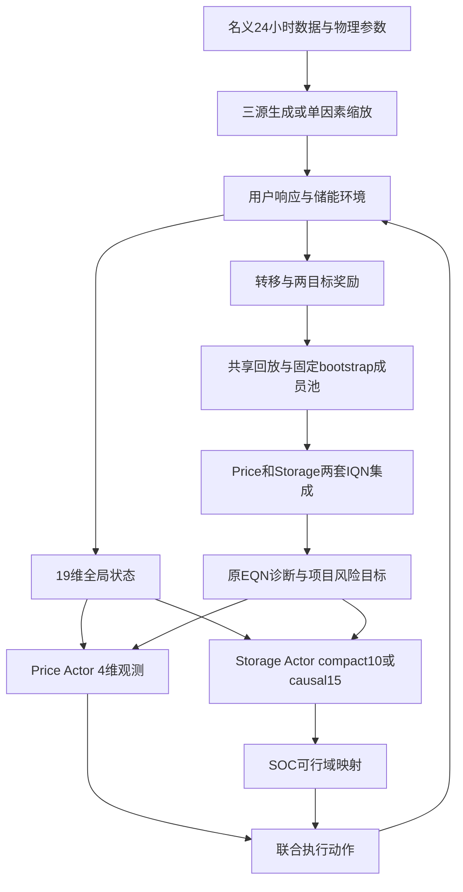

# EQN SAC 项目整体分析与原论文对照

> 归档副本说明：本文及所链接的 JSON、测试日志、SHA256 清单和补丁均在 2026 年 10 月 18 日目录迁移前生成。本文的“当前开发代码”“本轮”及后续工作建议描述当时状态；当前仅整理目录与上传，创新点推进暂停。证据文件按原字节复制，未改写其中的旧路径、时间或核验结果；它们不替代迁移后仓库的检查。旧绝对路径对应的完整原件现保存在本地 `archive/local/` 下同名交接包或审查目录，GitHub 不包含这些归档。

2026年10月18日。本轮重点是项目整体结构、算法来源、实现正确性和代码可读性。已对照EQN自动驾驶原文、作者官方实现，以及包内电压控制应用论文，并对当前开发代码做保持训练行为的重构。

**总体判断：项目保留了EQN的集成分位网络核心，是面向定价与储能的双Actor EQN-SAC扩展，而不是原EQN的逐项复现。** bootstrap、冻结随机prior、IQN分位回归和偶然不确定性聚合顺序有原方法依据。最需要纠正的是把尾部分位分歧直接记作原EQN认知不确定性，以及把项目新增的自适应CVaR、Tail惩罚混写成原论文内容。代码已将这些概念分开，保留当前Actor优化目标。

## 一 项目究竟在解决什么

业务目标是在24小时售电任务内联合决定零售电价与储能运行，使利润与低尾风险之间取得可解释的权衡。风电、基线负荷与购电价格构成外生场景；零售价通过三类用户响应影响实际需求；储能改变购电量并产生吞吐成本。

当前控制结构是两个分散Actor、两套集中式价值集成。它有CTDE结构，但没有单一共同奖励：

- Price Actor读4维局部观测，输出一个共享零售价动作；其目标奖励为总利润。
- Storage Actor默认读compact10，输出储能动作；原始输出经过SOC可行域映射，正号充电、负号放电。
- 两套Critic都读19维全局状态与2维联合执行动作，每套默认5成员；一套拟合Price奖励，另一套拟合Storage奖励。
- Storage奖励为`0.1 × 总利润 + 0.9 × 储能边际净收益`。由会计关系可改写为`0.1 × 无储能零售利润 + 储能边际净收益`。这不能解释成“储能自身收益只占0.9所以被忽略”。

两套目标集成不是标准SAC用于取最小值的twin Q。Price与Storage信息不同、奖励不同，是否产生有效协同需要通过结果检验，不能只凭集中Critic结构推断。

19维状态的阅读重点：0–4为购电价、响应前净负荷、温度、时刻、风电；5为归一化SOC；6–8为上一小时三类用户的零售价，**不是三个时间滞后**；9为上一响应量；10–12为购电价滞后；13–15为已有信息构造的负荷预测；16–18为风电滞后。代码现在使用特征名派生索引，避免在网络和回放里重复写19、21、5等数字。

当前任务边界也影响算法解释：每日从初始SOC重新开始，日末SOC自由且无残值；储能不向电网出售电力；单因素实验只改变全天共用的一个缩放系数。它是有限期的受控研究环境。近期三组5000轮实验全是同一基础方法的单因素学习诊断，还没有完成四方法创新比较。

## 二 参考来源应分清

1. Hoel、Wolff、Laine，2023，*Ensemble Quantile Networks: Uncertainty-Aware Reinforcement Learning With Applications in Autonomous Driving*，DOI `10.1109/TITS.2023.3251376`。重点为PDF第3–6页、式(14)–(17)、算法3和表I。已同时检查[作者官方仓库](https://github.com/carljohanhoel/EnsembleQuantileNetworks)，固定源码版本为`7dfbed562f3e0c7552fa98a821db502ea565618c`。
2. *Uncertainty-Aware Deep Reinforcement Learning for Robust Autonomous Voltage Control*，2025 NAPS，DOI `10.1109/NAPS66256.2025.11272369`。这篇采用**EQN-DDPG**，不是EQN-SAC；关键在PDF第3页式(6)–(11)和第4页式(12)–(13)。
3. 当前项目把集成分位价值学习迁移到随机连续Actor和软Bellman目标，再加入双角色奖励、自适应CVaR与Tail惩罚。这些应明确写成项目方法设计。

精确到页码、公式和作者源码行链接的证据见[EQN对照记录](eqn_comparison.json)与[电压论文对照记录](voltage_comparison.json)。原论文和冻结代码没有被修改。

## 三 与原EQN一致的核心

| 原论文内容 | 当前实现 | 判断 |
|---|---|---|
| 每成员学习一个隐式分位价值函数，式(14) | `QuantileCritic`输出`[batch, quantile]`，集成后为`[member,batch,quantile]` | 保留核心结构 |
| `Z = learned + beta × frozen_prior` | prior结构与learned相同，权重冻结；保留对输入动作的导数 | 正确；连续Actor需要这条动作梯度 |
| 经验以概率p_add加入成员自己的子集，算法3步骤12–16 | Replay插入时决定归属，采样时不重抽mask | 符合方法；索引池只是节省存储的实现 |
| 分位Huber损失，式(16) | 对预测分位求和，对目标分位和batch取均值 | 缩放正确，不应再除以预测分位数 |
| 完整分布的Critic目标，式(15) | `tau`和`tau_next`均从[0,1]采样 | 正确；风险偏好不意味着把Critic目标也截成低尾 |
| 偶然不确定性为`Var_tau(E_k Z)`，式(17)前 | 当前使用其平方根，即`std_tau(mean_k Z)` | 与作者官方代码一致 |
| 64维cosine嵌入 | 当前基底0…63 | 正文写1…64，但作者实现也是0…63，不能当作off-by-one错误修复 |

原论文表I的prior尺度300、bootstrap概率0.5、分位数32与当前默认值相同。**prior=300并非凭数值大就能认定为写错。** 原文κ=10而项目κ=1，成员数原文10而项目每目标5；这是超参数/规模差异。本轮已经在代码中明确κ=1，没有为“对齐论文”悄悄改变训练。

作者实现直接使用标准差的依据是[`iqn_ensemble.py` 247–255行](https://github.com/carljohanhoel/EnsembleQuantileNetworks/blob/7dfbed562f3e0c7552fa98a821db502ea565618c/src/iqn_ensemble.py#L247-L255)；cosine基底见[`network_architecture_distributional.py` 136–142行](https://github.com/carljohanhoel/EnsembleQuantileNetworks/blob/7dfbed562f3e0c7552fa98a821db502ea565618c/src/network_architecture_distributional.py#L136-L142)。论文表I与作者参数文件也不是所有数值完全相同，因此引用时应注明采用哪一份配置。

## 四 最重要的公式差异

固定状态和联合动作后，令`z[k,b,n]`表示第k个成员在第n个分位上的预测。

原EQN定义的两个量是：

\[
U_a^2 = \operatorname{Var}_{\tau}\left(\mathbb E_k Z_{k,\tau}\right),\qquad
U_e^2 = \operatorname{Var}_{k}\left(\mathbb E_{\tau} Z_{k,\tau}\right).
\]

这里用平方标记方便对应代码中的标准差；原文在置信度判据中直接写方差，作者实现返回标准差。现在代码分别输出`aleatoric_std`和`epistemic_std`，方差需要时可取平方。

项目原来记录成`ue`的量实际是：

\[
D_{\rm tail} = \frac{1}{\binom K2}\sum_{i<j}
\frac{1}{|T|}\sum_{n\in T}|Z_{i,\tau_n}-Z_{j,\tau_n}|,
\quad T=\{n:\tau_n\leq \eta_{\rm tail}\}.
\]

它反映低尾分位形状的成员分歧，和原EQN的成员均值分歧不同。举例，两个成员分位分别为`[-1,1]`和`[-2,2]`：两者均值都为0，所以原EQN认知标准差为0；仅看低尾时，分歧为1。尾部形状确实提供了不同信息，但应作为项目新增代理说明，不能换个变量名就当作原公式。由于IQN没有强制分位单调，这个量也不能无条件称为精确Wasserstein距离。

**本轮已修正表达和诊断：** 将旧`price_ue/storage_ue`改为`price_tail_disagreement/storage_tail_disagreement`，另加`price_epistemic_std/storage_epistemic_std`。新增的原EQN指标只用于诊断，不加入现有Actor目标。

电压论文还有一个容易混淆的差异：其第3页式(11)使用`E_k[Var_tau Z]`，而原EQN使用`Var_tau[E_k Z]`。上述例子中两者方差分别为2.5与2.25，并不相等。当前项目跟随原EQN作者实现，不能同时声称严格采用电压论文式(11)。

## 五 从EQN迁移到本项目时改变了什么

| 项目 | 原EQN/电压应用 | 当前项目 | 应如何表述 |
|---|---|---|---|
| 动作选择 | 原EQN对离散动作argmax；电压论文用确定性DDPG Actor | 两个随机tanh-Gaussian Actor | 连续多角色SAC迁移 |
| 探索 | 原EQN每episode随机选一个成员进行近似Thompson探索 | 随机Actor加初始warmup | 未保留原EQN的成员驱动探索机制 |
| Critic目标 | 原EQN及电压论文均无熵项 | 各角色目标扣除各自`alpha × logpi` | 项目定义的soft return，不能当现金利润分布或纯环境噪声 |
| 目标更新 | 原EQN实验使用硬更新与Double DQN动作选择 | 当前Actor取下一动作，Critic用Polyak软更新 | Actor-Critic适配，不应机械补原离散argmax |
| 两套Critic | 原EQN一个奖励目标的集成 | Price/Storage各一套目标集成 | 不等于SAC的clipped twin-Q；当前没有每成员再取两Q最小值 |
| CVaR水平 | 原EQN使用预设风险水平进行训练 | `clip(exp(-adaptive_beta × Ua_std), min_level,1)` | 项目自适应机制，系数与奖励尺度有关 |
| Tail项 | 原EQN认知不确定性用于置信判断 | 直接在Actor目标中减去低尾分歧惩罚 | 项目方法扩展，需要独立消融证据 |
| 高不确定性处理 | 原EQN有阈值与backup；电压论文有动作修正/约束优化 | 当前无经济后备或接管 | 明确当前研究边界，不自行恢复旧后备 |

当前每目标j、每成员k的软目标可读为：

\[
y^j_{k}=c_r r^j+\gamma(1-d)\left[Z^{j,-}_k(s',a',\tau')-
\alpha_j\log\pi_j(a'_j\mid o'_j)\right].
\]

它只加入本角色的熵，不是两角色熵的总和。这可追溯到项目既有实现，属于目标定义。若论文写成“最大化共同利润加双方熵的总和”，就与代码不一致；不应在整理代码时直接改成另一个目标。

## 六 四个实验组的准确含义

`original`保留为CLI和配置键，但论文宜称为“EQN-SAC基础组”，避免和“原EQN论文”或“普通SAC”混淆。

| 配置arm | Actor风险价值 |
|---|---|
| original | 全分位集成均值 |
| adaptive_only | 自适应水平以下的分位均值 |
| tail_only | 全分位集成均值减去Tail惩罚 |
| full | 自适应低尾均值减去Tail惩罚 |

四组都通过SAC Actor目标`E[alpha × logpi − risk_value]`更新。Critic始终拟合完整分布，目标动作来自正在训练的Actor。它不是“先完全按风险中性训练，最后才改CVaR选动作”的流程。

当前低尾均值采用32个中点分位上的硬mask：水平0.1时取3个点，即0.09375的网格质量；水平小幅变化不一定改变选中点数。风险水平还明确停止梯度。这是离散近似，并非对连续风险水平完整求导。**本轮将近似写入代码注释与公式说明，没有把它悄悄改成另一种算法。** 训练分位近似与评价阶段的经验CVaR10是不同计算，不应混为一项。

## 七 已落实的可读性改进

- `risk.py`单独承载原EQN诊断和项目扩展，使用具名`RiskStatistics`，消除`ua/ue`和元组位置的歧义。旧`risk_value`四元组保留兼容入口，文档明确第三项含义。
- `Agent.update`变成清晰的四阶段调度，具体逻辑分别在`_update_critics`、`_update_actors`、`_update_temperature`、`_update_targets`。动作固定与梯度路径由专门函数解释。
- 网络、回放统一引用`STATE_DIM`、`ACTION_DIM`和特征索引；保留模型参数键与状态顺序。形状`[K,B,N]`、动作符号、prior梯度和分位损失归约均有明确注释。
- 环境、场景生成中的缩写展开为负荷、价格、能量、充放电等具体含义；解释风电均值校准、响应随机流和日尺度缩放；替换难读的lambda，关键物理公式保留原计算顺序。
- 日志与Agent共享`UPDATE_METRIC_NAMES`，不再分别维护数字11和对应列序。日志区分偶然标准差、原EQN认知标准差、尾部分歧、风险水平与SAC温度。
- 配置按网络、回放、目标、优化器、研究扩展、场景和输出分组注释，明确熵温度与CVaR风险水平是不同概念。

阅读顺序建议为`environment.FEATURES/step` → `networks.QuantileCritic` → `risk.risk_statistics` → `agent.Agent.update` → `runner.train`。先理解状态/奖励，再看价值分布，最后看训练控制流程。

## 八 验证与保留边界

本轮44项单元测试通过，其中5项新增手算回归直接验证原EQN统计、Tail区别和硬mask梯度。测试日志见[测试日志](测试日志.txt)。

四个arm各进行3次连续更新，使用两个独立进程加载重构前后代码：完整模型、优化器、Actor/tau随机流、动作、回放采样索引及原11项指标均逐位相同；新增认知标准差独立核对。见[算法等价验证](algorithm_equivalence.json)。

另比较156个场景、312条24小时轨迹，每版本7,488次环境step；状态、奖励、结算、预测、可行域与最终响应随机流均精确一致。见[环境等价验证](环境场景重构等价验证.json)。这些验证证明本轮整理保留了受测行为，不代表长期性能提升。没有为了贴合原论文改变超参数或启动正式长训练。

后续最有价值的工作是先把论文的方法定义写准，再验证方法贡献：在统一环境、奖励尺度和信息条件下，分别检验自适应风险水平与Tail项是否改善真实利润低尾，并同时看均值代价和储能动作。当前三组单因素Original结果不能回答这两个创新是否有效。

文件变更见[本轮补丁](可读性重构.patch)，当前开发代码的校验见[核验结果](文件核验结果.json)。上一轮数值问题修复仍保留，但不作为本轮算法分析的主线。
