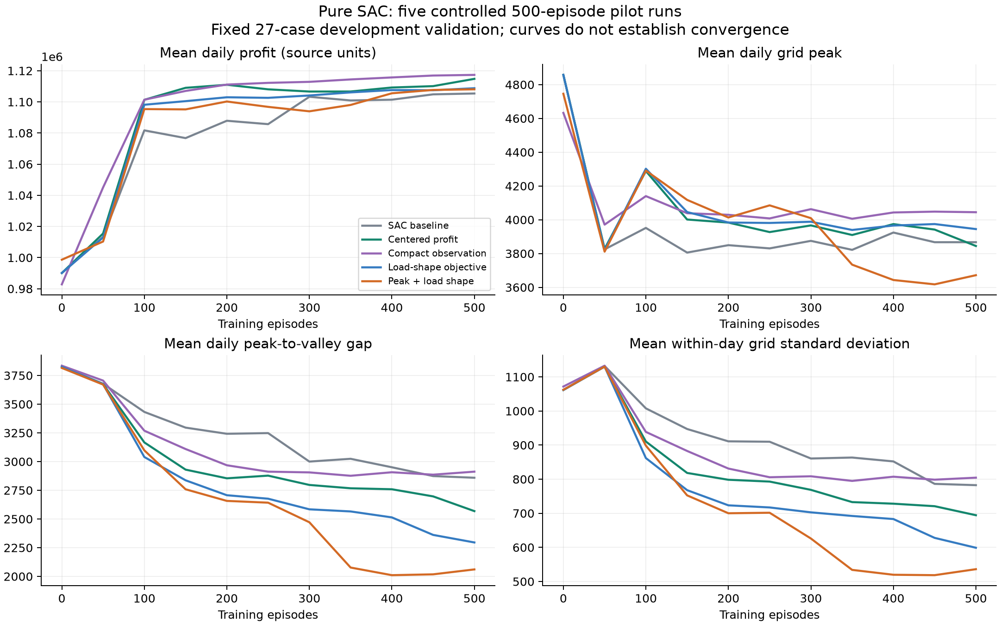
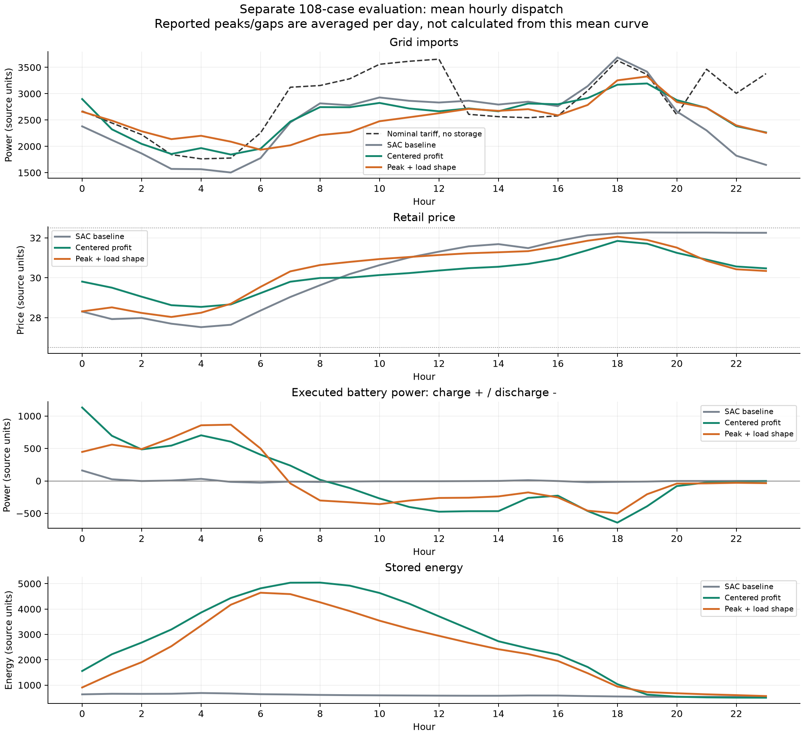

# SAC：五组 500 episode 试验

本目录保存 2026-10-18 完成的纯 SAC 试验。每组训练 500 回合、12000 环境步、11001 次更新，训练 seed 均为 42。算法与原 EQN 实验不同；两项创新扩展没有启用。

五组目录依次为 `baseline`、`centered`、`compact`、`balanced` 和 `peak_balanced`。业务目标、结果和文献依据见[审核报告](../../docs/sac/review-20261018.md)，训练入口见[运行指南](../../docs/sac/README.md)。

| 文件 | 含义 |
|---|---|
| `comparison.csv` | 108 场景的逐组日均经济/曲线指标 |
| `comparison.json` | 试验协议、配对差值与场景 bootstrap 区间 |
| `development_comparison.png` | 固定 27 场景、每 50 回合的评价曲线 |
| `heldout_dispatch.png` | 独立 108 场景的逐时均值动作与购电曲线 |
| `<组名>/config.json`、`manifest.json` | 实际配置、依赖和源码哈希 |
| `<组名>/source/` | 该次运行实际使用的冻结源码与数据 |
| `<组名>/training.csv`、`complete.json` | 500 回合日志及完成计数 |
| `<组名>/development_metrics.json` | 0—500 回合共 11 次阶段评价摘要 |
| `<组名>/holdout_108.json` | 独立评价全部案例与逐时记录 |
| `<组名>/physical_checks.json` | 独立复算与物理约束核验 |
| `<组名>/checkpoint.json` | 本地模型路径、大小和 SHA256 |
| `audit/` | 测试、算法审查、环境诊断及文献元数据 |

108 场景包含 27 种档位组合各 4 次随机实现，所有方法共享同一外生场景和响应随机数，使用最终第 500 回合模型。开发集与评价集使用不同 seed；全部五组配置完成后才评价该套件，没有再依据它调参。均衡压力评价和训练抽样分布不同，不能直接解释为真实市场或训练分布的预期收益。

bootstrap 区间只度量固定模型下的场景差异，不覆盖重新训练的波动。峰值配置还多了一个状态维度，改变了网络初始化，不能将其改善完全归因于某个独立因素。500 回合和单个训练种子不足以证明收敛。

图中的轨迹是逐时跨案例均值；表中的峰值、峰谷差与标准差则先逐日计算再平均，二者不应混算。收益、价格、功率和能量保留源数据单位，未核实币种或量纲换算，不标注为人民币。

模型权重仍在本机 `runs/sac_<组名>_500/checkpoint_00500.pt`，不放入普通 Git。Git 副本包含可审查的完整评价与训练源码；没有权重时可重新训练，但不能直接加载本次模型。冻结源码与当前开发源码存在训练后校验改进的差异，复核本次模型请配合该组自己的 `source/train_sac.py`。

重新汇总本机五组日志和生成图：

```sh
python -m pip install -r requirements-analysis.txt
python tools/compare_sac_runs.py --runs-root runs --output checks/sac_comparison_rebuilt
```




