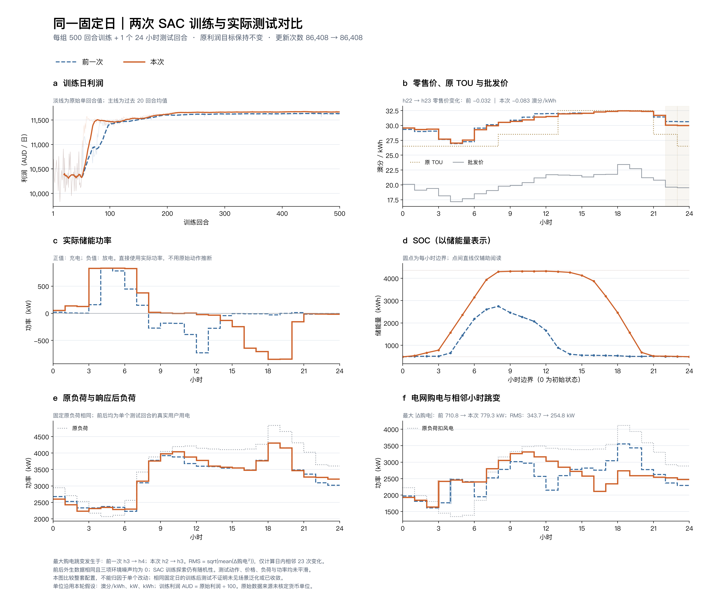

# causal13：增加因果状态后的固定日500+1

本轮相对调参后的current6，晚峰留电和放电明显改善，日利润增加约0.331%，购电峰值下降6.73%、相邻变化RMS下降25.86%。但最大购电跳变增加9.64%，因此不能宣称全日全面平滑。这些结论限于本次固定日、单seed的唯一测试。

## 单次结果与主要取舍

[高清PNG](figures/fixed_day_comparison.png) · [PDF](figures/fixed_day_comparison.pdf) · [逐小时CSV](figures/hourly_comparison.csv) · [完整离线指标](run/offline_comparison.json)

| 指标 | 上一轮current6_tuned | 本轮causal13 |
|---|---:|---:|
| 日利润，原始数值 | 1,165,894.88 | 1,169,753.64 |
| 储能边际利润，原始数值 | 580.89 | 4,195.43 |
| 零售价与批发价Pearson相关系数 | 0.9241 | 0.9462 |
| h10–14零售均价，澳分/kWh | 31.8920 | 31.5793 |
| h11–15负荷加权削减率 | 13.1875% | 11.1459% |
| 购电峰值，kW | 3553.36 | 3314.20 |
| 购电相邻变化RMS，kW | 343.69 | 254.80 |
| 最大相邻购电变化，kW | 710.76 | 779.30 |
| 用户负荷相邻变化RMS，kW | 316.02 | 309.58 |
| h18开始可用储能量，kWh | 48.89 | 1976.14 |
| h17–20放电量，kWh | 39.95 | 2547.99 |

储能不再把绝大多数能量提前用在白天：h8–15占全天放电的比例由96.72%降至11.73%，h17–20提高到69.92%。h15结束时高于SOC下界的能量由66.23增至3389.32 kWh；h18仍有1976.14 kWh可用。充电能量加权批发价17.80→18.11，放电加权价21.09→22.29，价差扩大。储能边际利润指本次价格、响应下相对零储能的会计差，不含投资成本。

午间均价下降约0.313澳分/kWh，加权削减率下降约2.042个百分点。原TOU谷/平/峰时段的零售均价仍递增，22→23时价格下降约0.083。相关性和窗口均值改善不代表每小时都同方向变化。

**最大跳变仍需保留为问题。** 本轮最大购电跃升发生在h2→3：充电125.20→827.36 kW，增加702.16；用户负荷2235.69→2312.83 kW，增加77.14；风电不变且均无放电，合计增加779.30 kW。上轮最大值在h3→4，为710.76 kW。因此平均变化幅度减小，不等于最剧烈的一次变化也减小。

低负荷六小时（h1–6）的用户需求总量仍较原负荷减少1.59%，填谷主要来自储能充电；该时段购电量较原负荷扣风电提高34.24%。高负荷六小时（h10、11、17–20）的购电量较原负荷扣风电减少24.43%。不能把储能填谷直接说成用户需求响应已经完成移峰补回。

RMS只计算日内23个相邻差分，不拼接跨日数据。测试价格、功率与负荷保持真实单次轨迹，不做平滑或多案例平均；训练利润图另叠加20回合尾随均值。

## 状态、训练和核验边界

[本轮配置](run/config.json)相对[上一轮配置](../sac_current6_tuned_500_20261018/run/config.json)，唯一字段变化是 `observation: current6 → causal13`。保留原6维当前信息及固定尺度，追加正余弦时钟、过去1/2/3小时批发价和当前可行动作上下界。日初缺失历史用第0小时价格填充，不跨日读取未来；不输入未来报价、预测、全日统计量、响应参考价、曲率或温度因子。

上下界是原SOC和功率限制的观测，没有新增约束。逐时a、b、设备、响应公式、动作映射及 `0.001×原利润` 奖励不变。预热1200步、Actor学习率 `2e-5`、目标熵−2及全部其他超参相同，仍为联合Actor和两个标量Critic。

seed 42、同一个固定24小时日、三项环境噪声全0；SAC探索和回放仍有随机性。实际完成500回合、12000步、86408次更新，耗时179.238秒；内部评价关闭，最终只测试1回合、24步。见[完成记录](run/complete.json)、[单次测试](run/test_1ep.json)和[测试执行来源](run/provenance_test.json)。离线计算与绘图没有再次调用策略。

[103项单元测试通过](checks/unit_tests.log)，本轮参数允许范围、配对数据、奖励恒等式和物理平衡等[离线核验](checks/validation.log)通过，另附[独立审核](checks/independent_review.txt)。训练来源见[源码清单](run/manifest.json)，图表来源见[绘图清单](figures/comparison_manifest.json)，文件来源与哈希见[归档清单](archive_manifest.json)。

此次追加的是函数表达，不是补足固定日缺失的Markov信息；一次增加7维且改变网络输入形状，不能分离各特征与初始化的贡献。固定日重复学习不证明未知日期泛化，也不保证以后都能留足晚峰电量。单位沿用澳分/kWh、kW、kWh的建模假设，利润原值按澳分理解，原始来源单位尚未核实。逐维定义及复现命令见[状态说明](../../docs/sac/causal-observation.md)。
