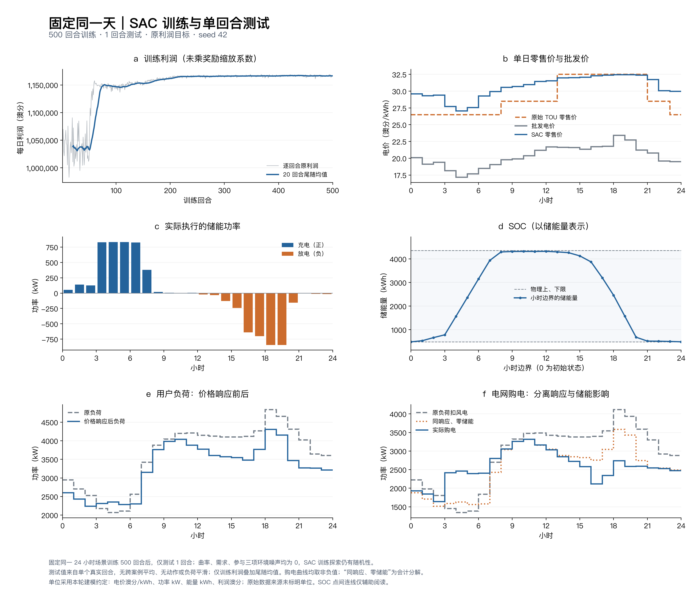

# SAC causal13：固定日500+1

这是 `sac` 分支当前唯一保留的纯SAC实验版本。配置、训练权重、500回合日志、唯一1回合测试及训练时冻结源码均已保存。此次整理只清理旧版本并生成单版本展示图，没有改变模型、参数或既有结果，也没有重新训练或执行策略测试。

[高清PNG](figures/fixed_day_results.png) · [PDF](figures/fixed_day_results.pdf) · [逐小时CSV](figures/hourly.csv) · [当前指标](result_summary.json)

## 当前结果

| 指标 | 数值 |
|---|---:|
| 日利润，原始数值 | 1,169,753.64 |
| 储能边际利润，原始数值 | 4,195.43 |
| h10–14零售均价，澳分/kWh | 31.5793 |
| h11–15负荷加权削减率 | 11.1459% |
| 购电峰值，kW | 3314.20 |
| 购电相邻变化RMS，kW | 254.80 |
| 最大相邻购电变化，kW | 779.30 |
| h18开始可用储能量，kWh | 1976.14 |
| h17–20放电量，kWh | 2547.99 |

储能主要在低批发价时充电，在晚峰放电；h17–20占全天放电69.92%。实际充电和放电能量加权批发价分别为18.1099、22.2906。23时零售价29.9852，比22时的30.0679略低。

仍有凌晨h2→3的购电跳变：充电功率增加702.16 kW、用户负荷增加77.14 kW，合计779.30 kW。低负荷时段的填谷主要来自储能，用户侧需求整体仍略减。单seed、同一固定日的结果不能证明未知日期泛化或全局最优。储能边际利润是同一价格和响应下相对零储能的会计差，不含投资成本。

## 配置、权重与来源

- [唯一配置](run/config.json)：13维当前/历史状态，两个连续动作，联合Actor与双标量Critic。
- [500回合模型权重](run/checkpoint_00500.pt)：与唯一测试所用文件逐字节一致，SHA256见[版本记录](version.json)。
- [冻结源码入口](run/source/train_sac.py)及[源码哈希](run/manifest.json)：用于复现和加载这份检查点。
- [训练日志](run/training.csv)、[完成记录](run/complete.json)、[唯一测试](run/test_1ep.json)、[测试来源](run/provenance_test.json)。

训练为固定无环境扰动的24小时数据、seed42、500回合、12000步、86408次更新，耗时179.238秒；内部评价关闭，最终只测试1回合。预热1200步、Actor学习率2e-5、Critic学习率5e-4、目标熵−2，奖励保持 `0.001×原利润`。逐时效用a、b和设备参数以配置及有效环境快照为准。

13维状态包括当前批发价、原负荷、风电、SOC、剩余时间、当前原TOU，另加正余弦时钟、过去3小时批发价和当前可行充放电边界。没有未来报价、全日统计量或响应参考价、曲率、温度因子。上下界来自原有物理，没有增加约束。完整定义与复现命令见[状态说明](../../docs/sac/causal-observation.md)。

## 整理与核验

清理后[103项单元测试通过](checks/cleanup_unit_tests.log)。当前源码、配置、模型、日志和单次测试的哈希保持不变；旧SAC实验、配置、权重、比较图和专用脚本已从当前文件树清理。文件核验见[归档清单](archive_manifest.json)，删除范围见[清理记录](cleanup_manifest.json)，单版本图来源见[绘图清单](figures/artifact_manifest.json)。

训练前选择记录及原始测试来源保留原字节，其中历史路径仅记录当时来源，不是当前可运行入口。旧提交仍在Git历史中；当前模型训练时的版本记录为 `090ea7a7919599b3fddc1f9cf638409be38a6a3e`。EQN原始资料与历史实验不属于本次旧纯SAC版本清理范围。

图中24小时动作、SOC、负荷和购电均直接来自保存测试；只有训练利润增加20回合尾随均值。单位沿用澳分/kWh、kW、kWh的建模假设，原始来源单位尚未核实。
