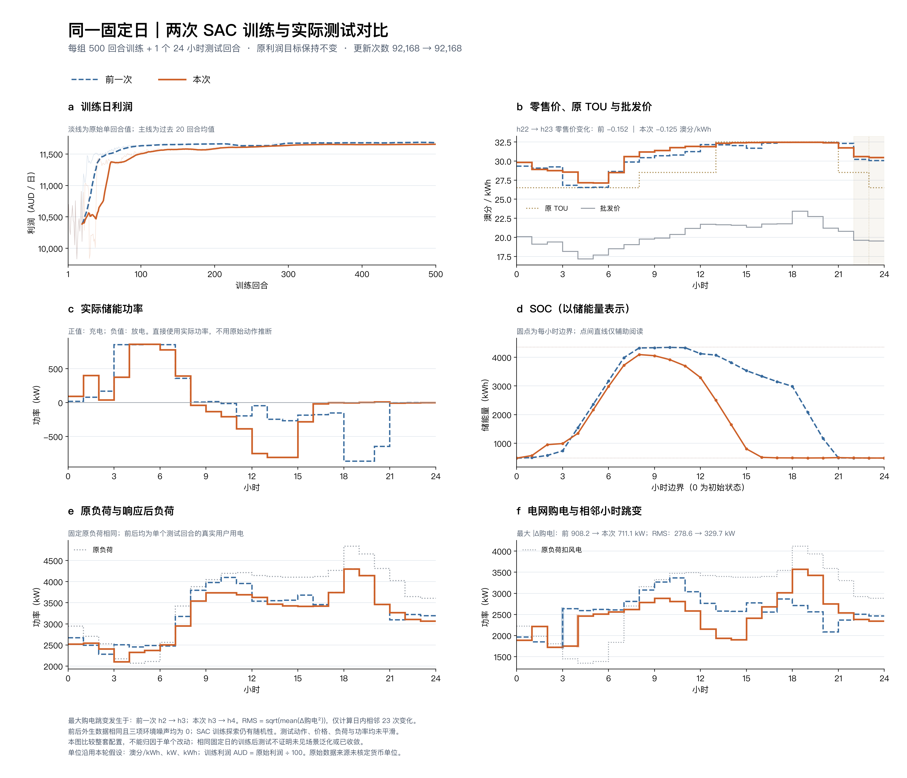

# 当前6维状态：固定日500回合训练、1回合测试

本轮完成用户要求的状态精简。相比上一轮17维状态，用户负荷的小时变化和最大购电跳变有所改善，但午间价格、削减率和购电峰值上升，储能收益明显下降。**这是一份仅使用当前信息的基线记录，不能视为优于17维的最终方案。**

## 单次测试结果

[高清PNG](figures/fixed_day_comparison.png) · [PDF](figures/fixed_day_comparison.pdf) · [逐小时CSV](figures/hourly_comparison.csv) · [离线指标](run/offline_comparison.json)

| 指标 | 上一轮dispatch17 | 本轮current6 |
|---|---:|---:|
| 零售价与批发价Pearson相关系数 | 0.934 | 0.912 |
| h10–14零售均价，澳分/kWh | 31.667 | 32.082 |
| h11–15负荷加权削减率 | 11.634% | 14.743% |
| 日利润，原始数值 | 1,168,821.86 | 1,165,994.36 |
| 储能边际利润，原始数值 | 4,064.48 | 758.62 |
| 购电峰值，kW | 3,365.46 | 3,573.18 |
| 购电相邻变化RMS，kW | 278.565 | 329.691 |
| 最大相邻购电变化，kW | 908.16 | 711.08 |
| 用户负荷相邻变化RMS，kW | 319.77 | 277.74 |

日利润下降约0.242%，午间削减率增加3.109个百分点。价格仍有整体TOU趋势：按原TOU谷/平/峰分组的零售均价为28.895/31.512/32.440，22→23时也仍下降。但这次精简没有继续降低午间价格。

“更平滑”需要区分曲线与指标：用户响应后负荷的变化RMS下降，最大购电跳变也下降；电网购电的变化RMS和峰值却上升，不能概括为全部改善或全部变差。RMS取日内23个相邻差分，不拼接跨日数据。测试动作、负荷没有平滑，也没有多案例平均；训练利润图单独叠加20回合尾随均值。

本轮储能在午间提前放出大部分可用能量：h15结束仅剩约26.86 kWh高于SOC下界，h17、h18放电约1.41、3.10 kW，晚峰支撑很弱。充电能量加权批发价18.08→18.15、放电加权价22.20→21.40，价差缩小。储能边际利润是在本次价格和响应下，相对零储能的会计差，不含投资成本。

## 改动与核验边界

[本轮配置](run/config.json)相对[上一轮配置](../sac_midday_price_500_20261018/run/config.json)，仅 `observation` 从 `dispatch17` 改为 `current6`。6维顺序为当前批发价、原始总负荷、风电、可用SOC比例、剩余时间、当前TOU；价格使用固定 `(price-20)/2`，负荷和风电除以5000。常数在训练前冻结，不按本日全日统计量计算。

未来报价及其极值、有效响应参考价、曲率和温度因子均不进入网络；响应模型仍在环境内部保留。逐时a、b、物理约束、动作映射、设备、训练超参及 `0.001×原利润` 奖励不变。架构仍为一个联合Actor、两个标量Critic，均接6维状态，未改为双Actor或EQN。

训练使用seed 42、同一固定日、三项环境噪声全0；SAC探索与回放仍有随机性。实际完成500回合、12000步、92168次梯度更新，耗时186.956秒。`evaluation_every=0`，最终检查点只测试1回合、24步，见[测试执行记录](run/provenance_test.json)和[完整测试](run/test_1ep.json)。对照及绘图只读取已有轨迹，没有补测模型。

[96项单元测试通过](checks/unit_tests.log)。离线核验确认前后有效环境与外生曲线相同、奖励恒等式和能量平衡成立，冻结源码哈希一致性检查通过；这不表示两轮源码完全相同，本轮新增了状态分支。参见[训练完成记录](run/complete.json)、[源码来源](run/manifest.json)、[绘图来源](figures/comparison_manifest.json)及[归档清单](archive_manifest.json)。

本轮状态内容、维度与归一化共同改变，单seed不能区分各删项的贡献；输入形状改变也影响初始化。固定日反复训练可以学到日程，不等于未见日期泛化。单位沿用澳分/kWh、kW、kWh的建模假设，利润原值按澳分理解，原始来源单位尚未核实。复现500+1和离线比较命令见[状态说明](../../docs/sac/current-observation.md)。
