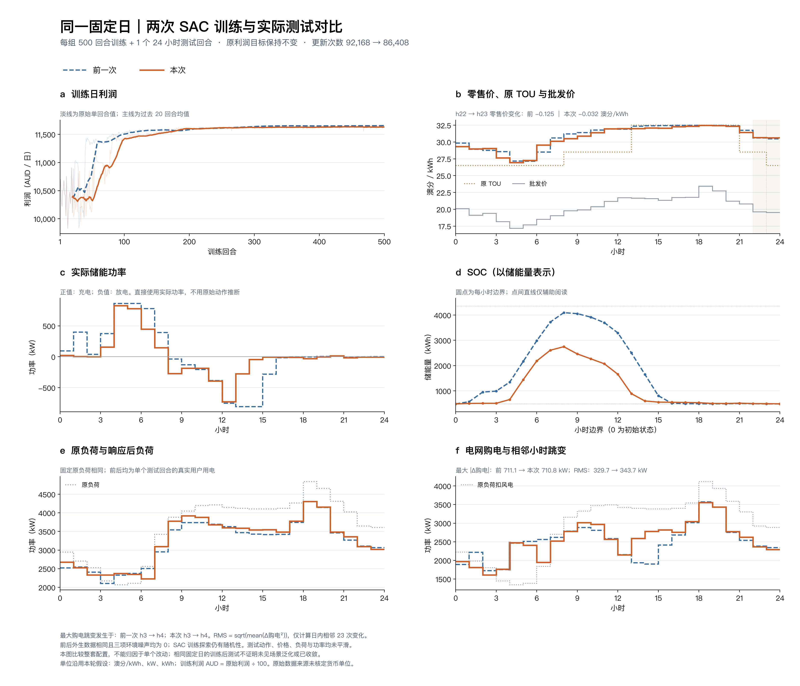

# current6训练超参调整：固定日500+1

本轮午间价格和削减率有所下降，日利润基本持平，但储能仍提前放电，晚峰支撑不足。购电峰值略降，用户负荷与购电的小时变化RMS均上升，不能称为全面改善。

## 三项设置与单次结果

[本轮配置](run/config.json)相对[上一轮current6](../sac_current6_500_20261018/README.md)仅改变以下三项：

| 参数 | 上一轮 | 本轮 |
|---|---:|---:|
| 预热步数 | 480 | 1200 |
| Actor学习率 | `5e-5` | `2e-5` |
| 目标熵 | −4 | −2 |

[高清PNG](figures/fixed_day_comparison.png) · [PDF](figures/fixed_day_comparison.pdf) · [逐小时CSV](figures/hourly_comparison.csv) · [离线指标](run/offline_comparison.json)

| 指标 | 上一轮 | 本轮 |
|---|---:|---:|
| 日利润，原始数值 | 1,165,994.3595 | 1,165,894.8774 |
| 储能边际利润，原始数值 | 758.62 | 580.89 |
| h10–14零售均价，澳分/kWh | 32.0824 | 31.8920 |
| h11–15负荷加权削减率 | 14.7432% | 13.1875% |
| 购电峰值，kW | 3573.18 | 3553.36 |
| 购电相邻变化RMS，kW | 329.69 | 343.69 |
| 最大相邻购电变化，kW | 711.075 | 710.760 |
| 用户负荷相邻变化RMS，kW | 277.74 | 316.02 |

日利润下降约0.00853%，午间削减率下降约1.556个百分点。最大购电跳变几乎不变，不能用这一指标的微降抵消RMS上升。RMS取日内23个相邻差分；单次测试动作与负荷不平滑、不平均多个案例，训练图另叠加20回合尾随均值。

储能充电量3814.83→2397.53 kWh，放电量3440.43→2159.13 kWh，参与程度下降。全天放电中，h8–15仍占98.986%→96.719%；h18开始时高于SOC下界的能量虽由6.914增至48.890 kWh，h17–20总放电也由4.512增至39.948 kWh，但仍仅占全天放电约1.85%。提前消耗可用能量的问题没有解决。储能边际利润是相同价格和响应下相对零储能的会计差，不含投资成本。

最后50回合各末次更新的日志记录中，熵均值−4.014→−1.967，alpha均值0.0411→0.1469，说明新熵设置已影响学习过程，但未解决储能择时。−2是二维联合动作的启发式，不由6维观测决定，也不强制实际熵精确等于−2。

## 协议、来源与限制

状态、归一化、逐时a、b、设备、约束和动作映射不变；环境奖励仍为 `0.001×原利润`，SAC软目标及探索会随熵超参改变。seed 42、固定同日、三项环境噪声为0，架构仍为联合Actor和两个标量Critic。

实际训练500回合、12000步、86408次更新，耗时175.878秒；加长预热使更新数从92168减少，没有追加回合补齐。内部评价关闭，最终仅测试1回合、24步，见[完成记录](run/complete.json)、[测试文件](run/test_1ep.json)和[执行来源](run/provenance_test.json)。后续指标与绘图只读取保存结果。

两轮[冻结源码和基础数据哈希](run/manifest.json)完全相同。本轮未重跑96项测试，沿用[上一轮测试记录](../sac_current6_500_20261018/checks/unit_tests.log)；本轮参数一致性及离线奖励、物理平衡核验通过，见[核验日志](checks/validation.log)、[绘图来源](figures/comparison_manifest.json)和[归档清单](archive_manifest.json)。

三项超参同时变化，单seed不能分离贡献；同日重复训练也不是未见日期泛化。单位沿用澳分/kWh、kW、kWh的建模假设，利润原值按澳分理解，原始来源单位尚未核实。冻结源码复现及离线比较命令见[方法说明](../../docs/sac/current6-training.md)。
