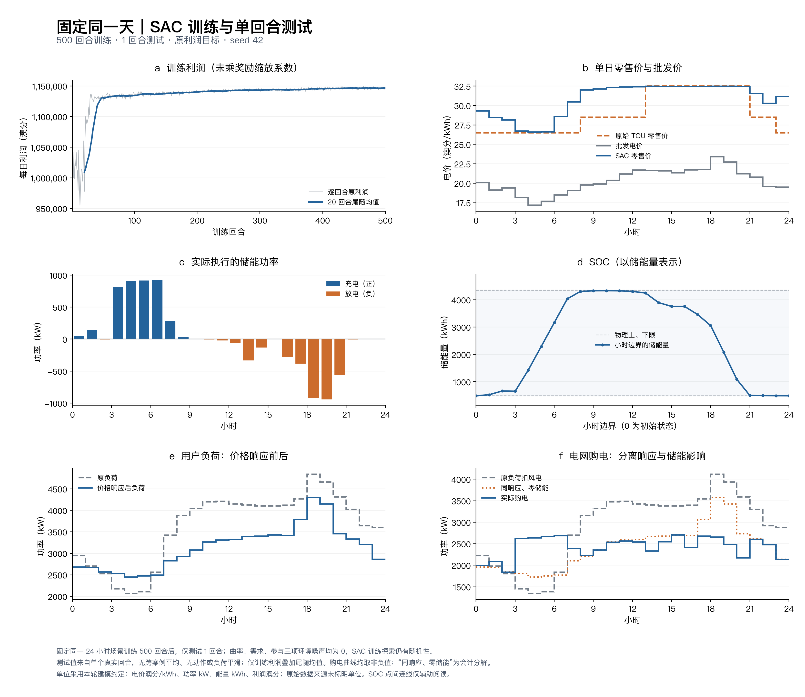

# 固定同一天：500 ep训练、1 ep测试

当前结果来自一个配置的一次完整500回合训练，最终模型仅测试1个24小时回合。训练和测试用相同的原始名义负荷、批发价与恒定20%风电，三项响应噪声全部为0。只调整参数、训练超参和状态；原利润奖励、响应公式、价格边界和动作规则不变。



[矢量PDF](figures/fixed_day_results.pdf) · [逐小时数据](figures/hourly.csv) · [测试原始记录](run/test_1ep.json) · [离线指标与物理核验](run/offline_diagnostics.json) · [配置说明](../../docs/sac/fixed-day-500.md)

图中测试动作、SOC与负荷均来自唯一真实测试回合，没有跨场景平均或平滑。只有训练利润额外显示20回合尾随均值；这不是多次策略评价的均值。

| 指标 | 原始/参考 | 本次单日结果 |
|---|---:|---:|
| 用户负荷峰值 kW | 4838.85 | 4301.67（−11.10%） |
| 用户负荷谷值 kW | 2067.46 | 2445.74（+18.30%） |
| 用户负荷峰谷差 kW | 2771.39 | 1855.92（−33.03%） |
| 用户负荷小时变化RMS kW | 307.11 | 234.81（−23.54%） |
| 用户日总电量 kWh | 86791.99 | 75294.41（−13.25%） |
| 购电峰值：同响应零储能→实际 kW | 3578.40 | 2702.38 |
| 购电小时变化RMS：同响应零储能→实际 kW | 234.81 | 261.11 |
| 利润：原TOU零储能→SAC，原货币单位 | 1103034.89 | 1148953.16（+4.16%） |

主要充电在3–7时，主要放电在18–20时，加权充/放电批发价18.024/22.308；初始/终止SOC为483.89/486.96 kWh。零售价与批发价相关系数0.863，原TOU谷/平/峰对应的平均零售价为28.444/31.873/32.462。

尚存不足：23时零售价与批发价出现局部反向变化，8–12时零售价偏高；储能后的购电曲线仍有跳变。用户负荷峰均比升高，日总用电减少，因此不能把需求削减全部称为移峰。这里只验证同一固定日，不代表其他日期或随机场景效果。

## 复核与复现

完成记录为500回合、12000环境步、46084次梯度更新，训练中策略评价0次，最终策略测试1次。86项单元测试全部通过。`run/`为原始运行的逐字节副本；`archive_manifest.json`记录29个文件的SHA256及未上传权重的SHA256。`run/provenance_test.json`在运行后记录实际测试命令与检查点、测试文件和源码的哈希。`figures/artifact_manifest.json`记录图表来源与产物校验值。离线指标只读取保存的测试轨迹，没有再次运行模型。

本机权重：`runs/sac_fixed_day_500/checkpoint_00500.pt`，未纳入Git。远程仓库含冻结源码、配置、实际输入、完整训练CSV和唯一测试JSON，可以复查图和数字，或重新训练。

如需重新训练，应使用新的输出目录：

```sh
python experiments/sac_fixed_day_500_20261018/run/source/train_sac.py train --config configs/sac/fixed_day_500.json --output runs/sac_fixed_day_repeat
python runs/sac_fixed_day_repeat/source/train_sac.py evaluate --checkpoint runs/sac_fixed_day_repeat/checkpoint_00500.pt --output runs/sac_fixed_day_repeat/test_1ep.json --cases 1 --seed 20260914
```

仅重新绘制已存结果，无需权重或运行策略：

```sh
python tools/plot_sac_fixed_day.py --run-dir experiments/sac_fixed_day_500_20261018/run --output checks/fixed_day_figures
```

绘图默认使用macOS的PingFang SC；其他平台可用`--font`指定已安装的中文字体。单位仍采用本轮明确约定：电价澳分/kWh，功率kW，能量kWh，利润澳分；原始数据来源尚未标注单位。
