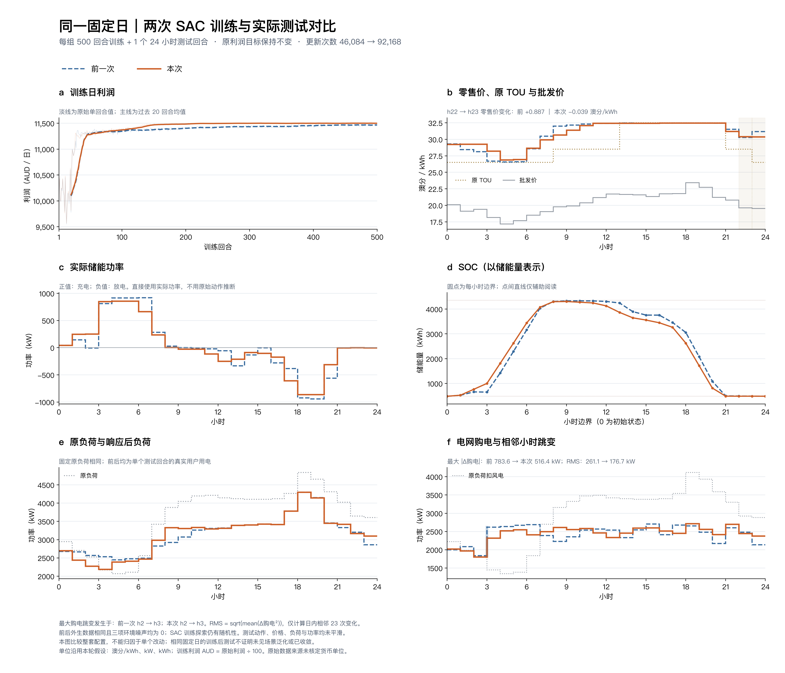

# 固定日500+1：23时定价与储能跳变改进

本轮新增一次500回合训练，最终模型仅测试1个24小时回合；前一次结果直接读取保存文件，没有重新测试。前后负荷、批发价、风电、温度、TOU及需求响应参数相同，三项环境噪声均为0。原利润奖励、响应公式和动作映射规则保持不变。



[高清PDF](figures/fixed_day_comparison.pdf) · [逐小时对比CSV](figures/hourly_comparison.csv) · [参数与解释](../../docs/sac/fixed-day-refinement.md) · [单次测试](run/test_1ep.json) · [离线指标与物理核验](run/offline_comparison.json)

蓝色虚线为[前一次500+1](../sac_fixed_day_500_20261018/README.md)，橙色实线为本次。所有测试曲线均为单次原始逐小时值，不做动作或负荷平滑；训练利润才叠加20回合尾随均值。

| 指标 | 前一次 | 本次 | 解释 |
|---|---:|---:|---|
| 22→23时零售价变化，澳分/kWh | +0.8873 | −0.0389 | 本次消除该时段反向上涨 |
| 最大购电跳变，kW | 783.63 | 516.42 | 减少34.10%，均发生在2→3时 |
| 购电小时变化RMS，kW | 261.11 | 176.73 | 减少32.32% |
| 20→21时购电跳变，kW | +431.13 | +279.63 | 减少35.14%，仍有台阶 |
| 储能功率最大跳变，kW | 818.83 | 599.45 | 减少26.79% |
| 储能功率小时变化RMS，kW | 306.21 | 244.42 | 减少20.18% |
| 购电峰值，kW | 2702.38 | 2715.06 | 略升0.47% |
| 购电标准差，kW | 236.94 | 217.55 | 下降8.18% |
| 用户响应后负荷小时变化RMS，kW | 234.81 | 257.10 | 变差9.49%，但低于原负荷307.11 |
| 用户响应后负荷谷值，kW | 2445.74 | 2191.57 | 填谷幅度减弱，原负荷谷值2067.46 |
| 全天利润，澳元* | 11489.53 | 11506.57 | 增加0.148% |
| 储能净贡献，澳元* | 46.38 | 41.40 | 下降10.73% |

*单位沿用建模假设：价格澳分/kWh、功率kW、能量kWh，原始利润除100为澳元；原数据的货币单位仍未恢复。

本次储能和购电的逐小时变化更平缓，23时反向上涨也已消除，但不是所有指标都改善。特别是单独的用户响应负荷更不平滑，填谷量减少，不能将其与储能后的电网购电混为一谈。2→3时仍有516.42 kW台阶，不能说跳变已完全消失。

## 本次调整

- 状态从11维改为17维：增加温度、当前物理可用充/放功率界、末小时标志，以及剩余名义最高/最低价到达时间。仅提供信息，不给动作目标。
- 充放电额定功率从967.77改为870.99 kW，即原始负荷峰值的20%改为18%；可用储能容量3871.08 kWh不变。这是设备参数变化，不是同一设备下的纯状态消融。
- Actor/Critic学习率分别减半到0.00005/0.0005；batch由128增至256，每环境步更新4→8次；初始温度0.1→0.05、目标熵−3→−4。其余超参包括gamma=1、reward_scale=0.001保持。

两次都是12000个环境步，但梯度更新46084→92168，因此不是等计算量比较。响应参数、风电和输入数据未改。变化只能归于整套配置，不能单独归于某一状态分量。

## 记录和复现

本次实际训练500回合、12000环境步，训练中策略评价0次，最终策略评价1次。`run/provenance_test.json`在执行前建立，记录实际命令、检查点SHA、完成状态和测试输出SHA；脚本拒绝覆盖已有测试。87项单元测试通过，SOC、购电平衡、功率上下限和无同时充放电核验通过。独立只读审查见`checks/independent_review.json`。

`archive_manifest.json`记录31个逐字节复制文件的SHA，以及留在本机的权重`runs/sac_fixed_day_refined_500/checkpoint_00500.pt`。图表清单记录前后输入、源码、脚本和产物SHA。没有上传权重；克隆后可直接看结果、重绘或重新训练。

重新训练须使用新的输出目录：

```sh
python experiments/sac_fixed_day_refined_500_20261018/run/source/train_sac.py train --config configs/sac/fixed_day_refined_500.json --output runs/sac_fixed_day_refined_repeat
python runs/sac_fixed_day_refined_repeat/source/train_sac.py evaluate --checkpoint runs/sac_fixed_day_refined_repeat/checkpoint_00500.pt --output runs/sac_fixed_day_refined_repeat/test_1ep.json --cases 1 --seed 20260914
```

仅重绘保存结果，无需权重：

```sh
python tools/plot_sac_fixed_day_comparison.py --before experiments/sac_fixed_day_500_20261018/run --after experiments/sac_fixed_day_refined_500_20261018/run --output checks/fixed_day_comparison
```

绘图可用`--font`指定已安装的中文字体。这是同一固定日上的测试，不证明跨日期泛化。
