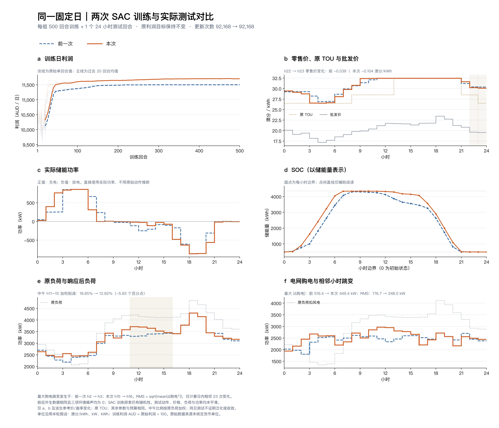

# 逐时二次效用a、b：固定日500回合训练、1回合测试

本轮针对中午负荷削减过重，仅调整逐小时二次效用函数 `U_h(L)=a_h L²+b_h L` 的24组a、b。测试中11–15时加权削减率由18.65%降至12.82%，中午响应明显减轻；最大购电跳变有所下降，但购电整体波动和峰值变大。这轮不能视为储能调度已经全面改善。

## 实际结果



[高清PNG](figures/fixed_day_comparison.png) · [PDF](figures/fixed_day_comparison.pdf) · [逐小时对比CSV](figures/hourly_comparison.csv) · [24组a、b与等价旧系数](run/hourly_utility_coefficients.csv) · [离线核验数据](run/offline_comparison.json)

| 指标 | 上一轮 | 本轮 | 解读 |
|---|---:|---:|---|
| 10时负荷削减率 | 20.52% | 14.61% | 中午前段削减减轻 |
| 11时负荷削减率 | 21.71% | 11.84% | 削减减轻9.87个百分点 |
| 12时负荷削减率 | 20.12% | 10.77% | 削减减轻9.35个百分点 |
| 11–15时加权削减率 | 18.65% | 12.82% | 减少5.83个百分点 |
| 用户负荷峰谷差，kW | 2107.79 | 1889.95 | 减少10.33% |
| 用户负荷小时变化RMS，kW | 257.10 | 262.53 | 增加2.11%，未全面变平滑 |
| 最大购电小时跳变，kW | 516.42 | 449.39 | 减少12.98% |
| 购电小时变化RMS，kW | 176.73 | 248.02 | 增加40.33% |
| 购电峰值，kW | 2715.06 | 2970.59 | 增加9.41% |
| 22→23时零售价变化，澳分/kWh | −0.039 | −0.104 | 本次仍向下，无反向上涨 |
| 日利润，原始数值单位 | 1150657.31 | 1171937.33 | 增加1.85% |

加权削减率是 `sum(原负荷−用户负荷)/sum(原负荷)`，窗口在训练前固定为h11–15，即11:00至16:00。负值表示增用电。所有小时均可在CSV核对，没有对测试价格、负荷或功率做平滑。小时变化RMS只使用日内23个相邻变化，不把23→次日0时拼接进去。最大购电跳变发生点从h2→3变为h15→16。

原TOU谷、平、峰时段的平均零售价为28.36、31.79、32.48，仍依次升高；零售价与批发价的Pearson相关系数从0.922降到0.896。总体趋势相符不代表每个小时都严格跟随，仍有11个小时处于既有价格上限附近。

储能充电的能量加权批发价为18.21，放电为22.26澳分/kWh；低价充、高价放的大方向保持。充电4066.18 kWh、放电3668.52 kWh，初末储能量483.885→485.164 kWh。功率最大跳变599.45→546.59 kW，功率变化RMS244.42→239.18 kW；但与用户负荷叠加后，购电整体波动仍上升。模拟储能净收益4140.37→3758.65原单位，下降9.22%。

剩余问题包括9时、20时负荷仍削减约20%，凌晨3–5时增用电约17%–19%，以及购电曲线较多的上下变化。本次没有新增补偿机制、爬坡约束或平滑奖励来隐藏这些问题。

## 修改范围与解释

- [运行配置](run/config.json)相较[上一轮](../sac_fixed_day_refined_500_20261018/run/config.json)仅新增`hourly_utility`。状态仍为dispatch17，训练超参、储能、新能源、TOU、批发价、零售价边界完全相同。
- a、b在7–15时作连续过渡调整，6时及16时以外保留旧响应的等价系数。24个时刻可各自独立设置；本次选择过渡平缓的参数形状，不是对输出负荷插值。
- 当前代码以曲率和响应参考价实现原二次效用响应。新入口使用 `curvature=−a`、`reference=b+2aB`，类别a按负荷份额换算，b保持共同值。响应公式、参与计算、价格/储能动作处理与原利润奖励不变。详细代数和数值边界见[系数说明](../../docs/sac/hourly-utility.md)。
- 本轮采用人工建模参数，并非实测消费者效用拟合。调整同时改变了需求响应环境，因而1.85%的利润增加不能解释为同一市场下纯粹的算法提升。a绝对值减小也不意味着所有价格处的响应敏感度都降低。
- 原响应没有跨小时补回机制，减少的用电不一定转移到其他时段；不能把全部削减量称为负荷转移。

## 运行与验证

新模型从头训练500回合、12000环境步、92168次梯度更新，耗时193.31秒。训练过程中没有执行策略评价；最终检查点只测试1回合、24步。对照读取上一轮已保存的唯一测试，没有重新运行旧模型。配置与参数选择在训练前记录于[选择记录](checks/selection_before_training.json)；静态方程计算只用于选参数，不是额外的模型测试。

训练和测试均使用相同的固定名义日，三项环境噪声均为0，风电恒定且日能量占名义负荷20%；SAC训练仍有随机探索、随机回放，单次固定日测试不代表泛化表现，也不能证明严格收敛。

92项测试通过，新增测试覆盖逐时a、b验证、原实现等价性、默认路径不变、状态与响应参考一致。独立审查未发现本轮范围内的实质缺陷；两份测试轨迹的SOC、功率、能量及购电物理核验通过。见[测试日志](checks/tests.log)、[独立审查](checks/independent_review.json)、[测试执行记录](run/provenance_test.json)。

[归档清单](archive_manifest.json)记录34个原样复制文件的SHA256，以及本地最终权重的大小和哈希。权重保留在本机`runs/sac_hourly_utility_500/checkpoint_00500.pt`，未上传；远程记录包含冻结源码、完整配置、500行训练日志、唯一测试轨迹和图表。绘图的[来源清单](figures/comparison_manifest.json)独立校验前后数据及变更范围。

单位沿用明确假设：功率kW、能量kWh、价格澳分/kWh，利润换成AUD时除以100。原始数据的来源和单位仍未恢复，不将结果称为已验证的澳大利亚实测收益。

复现请使用全新输出目录：

```sh
python train_sac.py train --config configs/sac/hourly_utility_500.json --output runs/sac_hourly_utility_new
python runs/sac_hourly_utility_new/source/train_sac.py evaluate --checkpoint runs/sac_hourly_utility_new/checkpoint_00500.pt --output runs/sac_hourly_utility_new/test_1ep.json --cases 1 --seed 20260914
```

仅重画已有记录，不调用Actor：

```sh
python tools/plot_sac_fixed_day_comparison.py --before experiments/sac_fixed_day_refined_500_20261018/run --after experiments/sac_hourly_utility_500_20261018/run --output checks/hourly_utility_replot --hourly-utility
```
