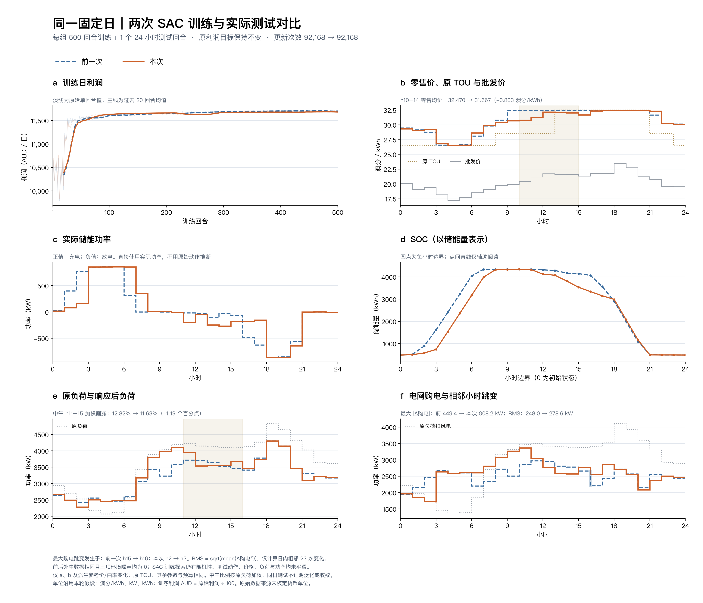

# 中午降价候选：固定日500回合训练、1回合测试

本轮继续只调整逐小时二次效用a、b，让中午零售价自然降低。固定同一天从头训练500回合后，唯一一次测试的10–14时零售均价从32.4699降到31.6668澳分/kWh，下降0.8030、约2.47%。价格目标达到，但购电跳变和峰值退步，因此保留为降价候选，不能视为全面改善的最终方案。

## 实际前后结果



[高清PNG](figures/fixed_day_comparison.png) · [PDF](figures/fixed_day_comparison.pdf) · [逐小时对比CSV](figures/hourly_comparison.csv) · [24组a、b](run/hourly_utility_coefficients.csv) · [离线指标](run/offline_comparison.json)

| 小时 | 旧零售价 | 新零售价 | 旧削减率 | 新削减率 |
|---|---:|---:|---:|---:|
| 10 | 32.458 | 30.782 | 14.61% | 2.28% |
| 11 | 32.466 | 31.237 | 11.84% | 6.10% |
| 12 | 32.471 | 32.162 | 10.77% | 14.75% |
| 13 | 32.478 | 32.121 | 11.64% | 13.94% |
| 14 | 32.477 | 32.033 | 14.10% | 13.22% |

价格降低不意味着每小时削减都降低：a、b共同改变了响应曲线。12、13时仍较上一轮削减更多，9、10时则仅削减约1.69%、2.28%，使这些时段购电负荷较高。不能用窗口均值掩盖这些差异。

| 指标 | 上一轮 | 本轮 | 变化 |
|---|---:|---:|---:|
| 10–14时零售均价，澳分/kWh | 32.4699 | 31.6668 | −2.47% |
| 11–15时加权削减率 | 12.8199% | 11.6343% | −1.19个百分点 |
| 日利润，原始数值单位 | 1171937.33 | 1168821.86 | −0.27% |
| 购电峰值，kW | 2970.59 | 3365.46 | +13.29% |
| 最大相邻购电变化，kW | 449.39 | 908.16 | +102.09% |
| 购电相邻变化RMS，kW | 248.02 | 278.56 | +12.32% |
| 用户负荷相邻变化RMS，kW | 262.53 | 319.77 | +21.81% |
| 22→23时价格变化，澳分/kWh | −0.1040 | −0.1520 | 该处仍向下 |

价格统计窗口在训练前固定为h10–14，即10:00至15:00，使用5个小时算术均价。削减窗口沿用上一轮h11–15，按原始负荷加权。RMS仅使用日内23个相邻变化，不拼接跨日数据；实际测试价格、功率、负荷未进行平滑。训练利润图另叠加20回合尾随均值。

储能仍主要低价充电、高价放电：充电能量加权批发价18.08、放电22.20澳分/kWh；原TOU谷/平/峰时段的零售均价28.46/31.12/32.26保持递增。零售价与批发价Pearson相关系数0.896→0.934，但不保证每个小时严格同向。储能边际利润3758.65→4064.48原单位（同价格、同响应下相对零储能的会计差，非包含投资成本的独立储能业务净利）。初末储能量483.885→484.764 kWh，所有物理检查通过。

最大购电跳变现在发生在2→3时。该处充电功率约167.4→852.9 kW，同时用户负荷约2281.7→2504.5 kW，两者相加产生约908.2 kW购电跃升。充放电时机大方向正确，不能据此宣称曲线平滑。21时削减约23.10%仍偏强。单独调整a、b，没有自动解决联合策略的全部问题。

## 参数与运行边界

[新配置](run/config.json)与[上一轮配置](../sac_hourly_utility_500_20261018/run/config.json)只有`hourly_utility`不同。训练超参、17维状态、储能、新能源、TOU、批发价、价格边界、原响应公式及原利润奖励均相同，冻结训练源码和基础数据哈希也完全相同。

午间h9–15采用`a=−0.000825`，b按`30.5+2×0.000825×名义负荷`计算；两侧用权重过渡：h7/8/16/17分别0.25/0.75/0.75/0.25，其他小时a、b原样保留。30.5是两系数推导出的需求响应零点，并非给策略的价格标签、价格目标或硬性限制。只有最终保存的24对系数进入环境。详细公式、前期静态利润分析与学习偏差说明见[参数依据](../../docs/sac/midday-price.md)。

训练500回合、12000环境步、92168次梯度更新，耗时195.35秒；`evaluation_every=0`，训练前/中途/结束时均不自动评价。最终检查点仅测试1回合、24步，见[执行记录](run/provenance_test.json)。对照直接读取上一轮保存的测试，没有重新运行其模型；后续图表和指标均为离线计算。

训练和测试使用同一固定名义日，三项环境噪声为0，风电恒定且能量占名义负荷20%；SAC训练探索与回放仍有随机性。相同日测试不能证明未知场景泛化或严格收敛。

参数构造及原输入配置`configs/sac/midday_price_500.json`的字节哈希在训练前写入[选择记录](checks/selection_before_training.json)。静态分析的完整报告在训练启动后整理完成，24对系数与预先固定配置逐值相同；运行目录中的配置由程序重新序列化，JSON值相同，字节哈希不要求相同，见[核验记录](checks/proposal_config_verification.json)。静态价格网格分析不调用Actor、不作为策略测试，也未向网络提供动作标签。

本轮核验了配置允许范围、前后冻结源码一致、唯一测试、奖励恒等式、物理平衡和配对数据。同一核心实现此前通过92项单元测试及GitHub CI；本轮没有再次运行这92项测试，也没有改算法源码。见[验证日志](checks/validation.log)及[绘图来源清单](figures/comparison_manifest.json)。

[归档清单](archive_manifest.json)保存35个原样复制文件的哈希；完整源码、训练日志和单次测试随Git上传。权重保留本机`runs/sac_midday_price_500/checkpoint_00500.pt`，清单记录SHA256，未上传权重。前一轮结果完整保留。

本轮a、b属于人工建模参数，并非实测客户拟合；利润差同时包含响应环境改变和策略重训，不能单独解释为算法性能变化。单位沿用澳分/kWh、kW、kWh的建模假设，利润换算AUD除以100；原始来源单位尚未核实。原响应模型没有跨时能量补回机制，削减不等于等量转移。

## 复现

使用全新的输出目录，最终模型只评价一次：

```sh
python train_sac.py train --config configs/sac/midday_price_500.json --output runs/sac_midday_price_new
python runs/sac_midday_price_new/source/train_sac.py evaluate --checkpoint runs/sac_midday_price_new/checkpoint_00500.pt --output runs/sac_midday_price_new/test_1ep.json --cases 1 --seed 20260914
```

仅用存档重画，不执行策略：

```sh
python tools/plot_sac_fixed_day_comparison.py --before experiments/sac_hourly_utility_500_20261018/run --after experiments/sac_midday_price_500_20261018/run --output checks/midday_price_replot --hourly-utility --midday-price-focus
```
